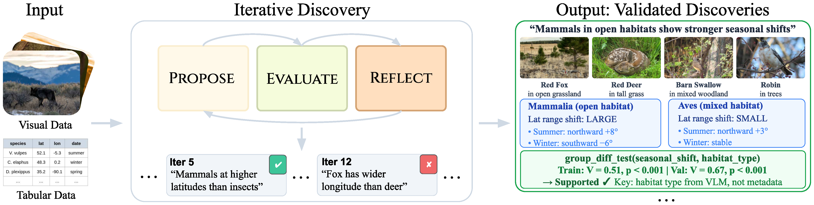
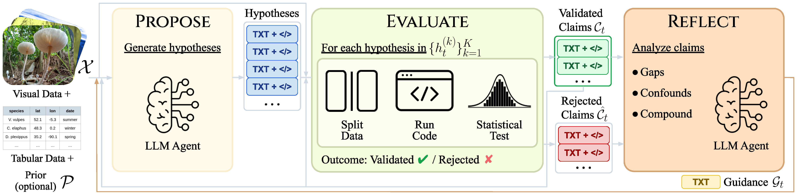
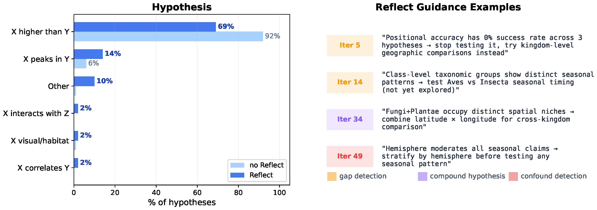
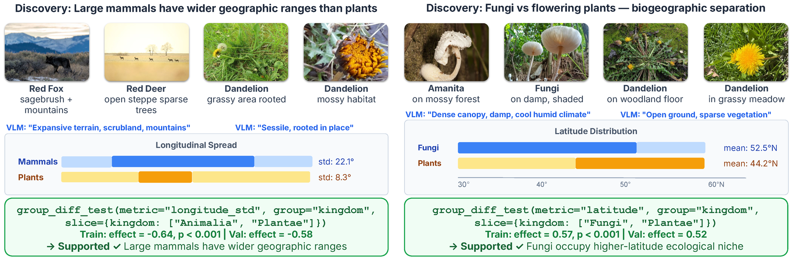
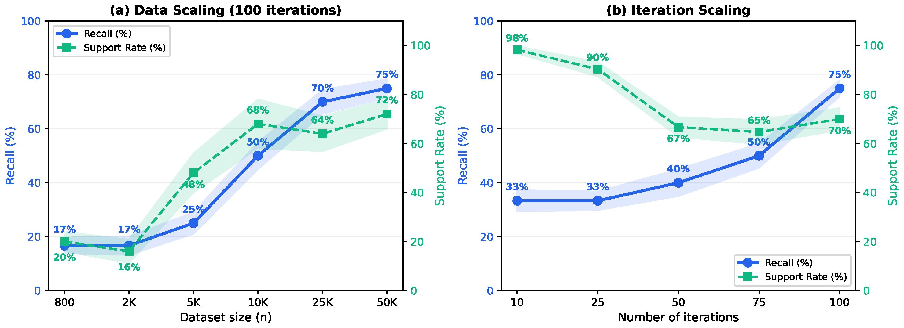

# DiscoPER: Autonomous Scientific Discovery via Iterative Meta-Reflection

Official implementation and benchmark suite for the NeurIPS 2026 paper:

> **Autonomous Scientific Discovery via Iterative Meta-Reflection**  
> Bingchen Zhao, Sara Beery, Oisin Mac Aodha  
> *Forty-First Annual Conference on Neural Information Processing Systems (NeurIPS 2026)*

<p align="center">
  
</p>

---

## Overview

**DiscoPER** (**Disco**very via **P**ropose–**E**valuate–**R**eflect) is an autonomous LLM-powered framework for open-ended, data-driven scientific discovery over tabular and multimodal datasets:

1. **PROPOSE (`core/discovery/hypothesis_generator.py`)**: Receives a dataset schema/summary and optional sample images, conditioned on accumulated claims (`C_{t-1}`) and reflection guidance (`G_{t-1}`), and proposes testable hypotheses without requiring a pre-specified research question (`P = ∅`).
2. **EVALUATE (`core/discovery/experiment_planner.py`, `experiments.py`, `insight_evaluator.py`)**: Maps each hypothesis to an executable statistical test (correlation, group comparison, predictive modeling, clustering + enrichment, stratified subgroup re-analysis, or VLM-based visual attribute/group tests) and validates it on both training and held-out validation splits (`|δ| ≥ 0.2`, `p ≤ 0.05`, and `|δ_val| ≥ 0.6 · |δ_train|`).
3. **REFLECT (`core/discovery/meta_discovery.py`)**: Periodically analyzes accumulated accepted (`C_t`) and rejected (`Ĉ_t`) claims to identify under-explored variable gaps, recurring confounds, and compound multi-variable hypotheses to steer subsequent iterations.

<p align="center">
  
</p>

---

## Key Results

### Open-Ended Pattern Rediscovery on iNatDisco

| Dataset | Method | Hypothesis Space | Reflect | Prior Info | Recall (Exact) | Support Rate |
| :--- | :--- | :---: | :---: | :---: | :---: | :---: |
| **iNatDisco-800** | LLM + PC / NOTEARS | Edge | ✗ | `∅` | 0/9 | — |
| | GPT-4 BFS | Edge | ✗ | `∅` | 1/9 | — |
| | Random Diversification | Open Code | ✗ | `∅` | 4/9 | 61.3% ± 4% |
| | HeurekaBench (Iterative) | Guided Code | ✗ | Partial | 4/9 | 64.0% ± 5% |
| | ExperiGen (Iterative) | Guided Code | ✓ | Partial | 5/9 | 61.2% ± 4% |
| | **DiscoPER w/o Reflect** | Open Code | ✗ | `∅` | 7/9 | 70.0% ± 2% |
| | **DiscoPER (Ours)** | Open Code | ✓ | `∅` | **8/9 (7/9)** | **72.7% ± 3%** |
| **iNatDisco-50K** | LLM + NOTEARS / GPT-4 BFS | Edge | ✗ | `∅` | 1/12 | — |
| | Random Diversification | Open Code | ✗ | `∅` | 3/12 | 60.8% ± 4% |
| | HeurekaBench (Iterative) | Guided Code | ✗ | Partial | 3/12 | 65.8% ± 4% |
| | ExperiGen (Iterative) | Guided Code | ✓ | Partial | 4/12 | 68.9% ± 4% |
| | **DiscoPER w/o Reflect** | Open Code | ✗ | `∅` | 6/12 | 66.6% ± 3% |
| | **DiscoPER (Ours)** | Open Code | ✓ | `∅` | **8/12 (6/12)** | **74.2% ± 3%** |

### How Meta-Reflection Steers Exploration & Vision-Grounded Discoveries

<p align="center">
  
</p>

<p align="center">
  
</p>

<p align="center">
  
</p>

---

## Repository Structure

```text
├── assets/                                 # Pipeline and results figures
├── core/
│   ├── agent.py                            # Base LLM agent interface
│   ├── litellm_backend.py                  # OpenAI-compatible / LiteLLM backend
│   ├── openrouter_backend.py               # OpenRouter multi-model backend
│   ├── discovery/
│   │   ├── hypothesis_generator.py         # PROPOSE module
│   │   ├── experiment_planner.py           # EVALUATE experiment design
│   │   ├── experiment_runner.py            # Deterministic execution wrapper
│   │   ├── experiments.py                  # 7 statistical & VLM test primitives
│   │   ├── tool_router.py                  # Sandboxed tool dispatch & split routing
│   │   ├── insight_evaluator.py            # Held-out statistical validation
│   │   ├── insight_store.py                # Persistent claim store (Parquet)
│   │   ├── meta_discovery.py               # REFLECT module
│   │   ├── llm_judge_evaluator.py          # LLM-as-a-judge semantic evaluation
│   │   └── types.py                        # Hypothesis, Experiment, Result, Insight types
│   ├── benchmark/
│   │   ├── inat/                           # iNatDisco-800 dataset adapter
│   │   ├── inat24/                         # iNatDisco-50K dataset adapter
│   │   ├── visual/                         # Synthetic visual benchmark generator & adapter
│   │   └── realworld_presets.py            # SACHS & ASIA causal discovery presets
│   ├── prompts/                            # System & user prompts for all modules
│   └── runners/
│       └── discovery_mvp_runner.py         # Main Propose-Evaluate-Reflect loop
├── config/
│   └── task/
│       ├── inat_discovery.yaml             # iNatDisco-800 main config (DiscoPER)
│       ├── inat24_discovery.yaml           # iNatDisco-50K main config
│       ├── inat_heureka_ablation.yaml      # HeurekaBench-like baseline
│       ├── inat_experigen_ablation.yaml    # ExperiGen-like baseline
│       ├── inat_controllability_prior.yaml # Controllability: prior knowledge
│       ├── inat_controllability_guided.yaml# Controllability: guided focus area
│       ├── visual_synthetic_discovery.yaml # Synthetic visual benchmark config
│       └── benchmark_discovery.yaml        # SACHS / ASIA causal discovery config
├── data/
│   ├── inat_subset/                        # iNatDisco-800 tabular metadata & ground truth
│   ├── inquire_benchmarks/                 # iNatDisco-50K ground truth patterns
│   └── realworld_benchmarks/               # SACHS & ASIA datasets + ground truth
├── scripts/
│   ├── download_verified_inat_images.py    # Download verified iNaturalist photos via API
│   ├── download_inquire_datasets.py        # Download iNat24 metadata & build inat24_50k.parquet
│   ├── download_inat_from_s3.py            # Download iNatDisco-50K images from S3
│   ├── generate_counterfactual_benchmark.py# Generate iNatDisco-800-CF counterfactual data
│   ├── generate_visual_synthetic.py        # Generate 5,000-image synthetic visual benchmark
│   ├── generate_realworld_benchmark.py     # Rebuild SACHS / ASIA benchmark directories
│   ├── run_data_size_scaling.py            # Data-size scaling experiments
│   ├── evaluate_discovery.py               # LLM-as-a-judge recall & support rate evaluation
│   └── plot_*.py                           # Paper figure generation scripts
├── launch_discovery.py                     # Main entry point for running experiments
└── results_browser.html                    # Self-contained interactive discovery browser
```

---

## Installation & API Configuration

```bash
conda create -n discoper python=3.11 -y
conda activate discoper
pip install pandas numpy scipy scikit-learn pyyaml pyarrow hydra-core omegaconf litellm tenacity openai httpx pillow matplotlib
```

Configure your LLM API credentials via environment variables:

```bash
export LITELLM_API_KEY="your-api-key"
export LITELLM_BASE_URL="https://your-openai-compatible-endpoint/v1"
```

Alternatively, pass `model_url=...` and `model_name=...` via Hydra CLI overrides when launching `launch_discovery.py`, or set `OPENROUTER_API_KEY` when using `core/openrouter_backend.py` for multi-model experiments (`claude-sonnet-4-5`, `claude-opus-4-6`, `gpt-5.4`, `deepseek-v4-pro`).

---

## Data & Benchmarks

The repository includes the tabular metadata and literature-curated ground truth for **iNatDisco-800** (`data/inat_subset/`), the ground truth for **iNatDisco-50K** (`data/inquire_benchmarks/inat24_ground_truth.json`), and the **SACHS** and **ASIA** causal benchmarks (`data/realworld_benchmarks/`) out of the box.

### 1. Download Verified Images for iNatDisco-800

To run multimodal discovery with VLM tools on **iNatDisco-800**, download the 800 verified research-grade species photographs directly from the public iNaturalist API:

```bash
python scripts/download_verified_inat_images.py --data-dir data/inat_subset
```

### 2. Generate Counterfactual Benchmark (iNatDisco-800-CF)

To construct the counterfactual benchmark where five ecological relationships are inverted in the tabular metadata while keeping images unchanged:

```bash
python scripts/generate_counterfactual_benchmark.py \
    --input data/inat_subset \
    --output data/counterfactual
```

### 3. Generate Synthetic Visual Benchmark

To generate the 5,000-sample synthetic visual benchmark with metadata-only, vision-only, and cross-modal ground-truth patterns:

```bash
python scripts/generate_visual_synthetic.py \
    --output data/visual_synthetic \
    --n-samples 5000
```

### 4. Download & Prepare iNatDisco-50K

To download the iNaturalist 2024 observation metadata (`train.json.tar.gz`) from the public competition S3 bucket, automatically build `data/inquire_benchmarks/inat24_50k.parquet` (50,000 observations, seed 42), and download the corresponding images from S3:

```bash
# Step 1: Download metadata and build data/inquire_benchmarks/inat24_50k.parquet
python scripts/download_inquire_datasets.py --datasets inat24 --output data/inquire_benchmarks

# Step 2 (optional, for vision tools): Download species images from the public S3 bucket
python scripts/download_inat_from_s3.py --data-dir data/inquire_benchmarks
```

---

## Running Discovery Experiments

### Main Open-Ended Discovery (DiscoPER)

```bash
# iNatDisco-800 (100 iterations, Reflect every 5 iterations)
python launch_discovery.py \
    --config-path=config/task \
    --config-name=inat_discovery \
    n_iterations=100 \
    model_url=$LITELLM_BASE_URL

# iNatDisco-800 without Reflect ablation
python launch_discovery.py \
    --config-path=config/task \
    --config-name=inat_discovery \
    n_iterations=100 \
    meta_discovery_args=null \
    model_url=$LITELLM_BASE_URL

# iNatDisco-50K (100 iterations)
python launch_discovery.py \
    --config-path=config/task \
    --config-name=inat24_discovery \
    n_iterations=100 \
    model_url=$LITELLM_BASE_URL
```

### Baselines & Controllability Ablations

```bash
# HeurekaBench-like baseline
python launch_discovery.py --config-path=config/task --config-name=inat_heureka_ablation n_iterations=100 model_url=$LITELLM_BASE_URL

# ExperiGen-like baseline
python launch_discovery.py --config-path=config/task --config-name=inat_experigen_ablation n_iterations=100 model_url=$LITELLM_BASE_URL

# Controllability: Prior Knowledge & Guided Focus
python launch_discovery.py --config-path=config/task --config-name=inat_controllability_prior n_iterations=100 model_url=$LITELLM_BASE_URL
python launch_discovery.py --config-path=config/task --config-name=inat_controllability_guided n_iterations=100 model_url=$LITELLM_BASE_URL

# Synthetic Visual Benchmark
python launch_discovery.py --config-path=config/task --config-name=visual_synthetic_discovery n_iterations=100 model_url=$LITELLM_BASE_URL

# Classical Causal Discovery Benchmarks (SACHS / ASIA)
python launch_discovery.py --config-path=config/task --config-name=benchmark_discovery benchmark_dir=data/realworld_benchmarks/sachs n_iterations=100 model_url=$LITELLM_BASE_URL
python launch_discovery.py --config-path=config/task --config-name=benchmark_discovery benchmark_dir=data/realworld_benchmarks/asia n_iterations=100 model_url=$LITELLM_BASE_URL
```

---

## Evaluation

Each run saves all evaluated hypotheses and held-out validation metrics to `results/<run_name>/insights.parquet`. To compute pattern recall and support rate using the LLM-as-a-judge protocol:

```bash
python scripts/evaluate_discovery.py \
    --ground_truth data/inat_subset/ground_truth.json \
    --discovered results/<run_name>/insights.parquet \
    --llm_judge \
    --model_url $LITELLM_BASE_URL
```

---

## Interactive Results Browser

Open `results_browser.html` directly in any web browser (no server required) to inspect discovered claims, train/validation effect sizes and p-values, VLM visual evidence, ground-truth literature matches, and generated statistical test code across **iNatDisco-800**, **iNatDisco-50K**, and the **Synthetic Visual Benchmark**.

---

## Citation

```bibtex
@inproceedings{zhao2026discoper,
  title     = {Autonomous Scientific Discovery via Iterative Meta-Reflection},
  author    = {Zhao, Bingchen and Beery, Sara and Mac Aodha, Oisin},
  booktitle = {Advances in Neural Information Processing Systems (NeurIPS)},
  year      = {2026}
}
```

## License

This project is licensed under the terms specified in [LICENSE](LICENSE).
